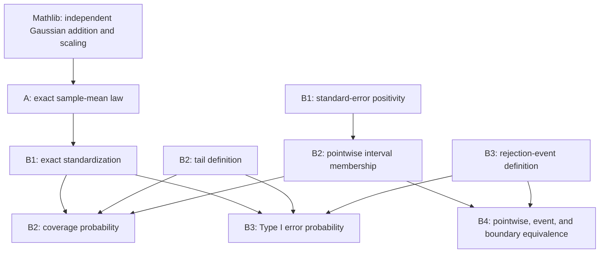

# Formal Verification of Exact Statistical Inference in Lean 4

**Machine-Checked Gaussian Sampling Distributions, Confidence Intervals, and Hypothesis Tests**

A formalization of a classical statistical argument: starting with a finite independent Gaussian sample, derive the distribution of its mean, construct an exact confidence interval and test, and prove that their decisions agree for every sample outcome.

**Start here:** [Two-minute project overview](PROJECT_OVERVIEW.md) · [Proof map and theorem inventory](PROOF_MAP.md) · [Lean source](LeanStatInference/) · [Reproduce verification](#verification)

## Project overview

Statistical conclusions depend on assumptions. An exact Gaussian confidence interval, for example, requires a different justification from an approximation based on a large sample. A written proof can leave independence, measurability, or endpoint conventions implicit. This project makes these requirements explicit in Lean 4 and connects them to precise conclusions.

Lean is an interactive theorem prover: a proof produces a term that its kernel checks against a mathematical statement. Mathlib supplies the underlying analysis and probability theory. This project builds a small statistical development on that foundation. Its results concern entire probability distributions and exact event probabilities, rather than simulations or numerical agreement.

All five stages are implemented. The statistical results are classical; the contribution is their explicit formalization and integration. Development was substantially AI-assisted, as described [below](#ai-assisted-development).

## Main mathematical results

### Probability model and notation

For the probability theorems, let $P$ be a probability measure on an arbitrary measurable space $\Omega$. Let $n>0$, $\sigma>0$, and let $X_1,\ldots,X_n$ be measurable, **mutually independent** observations with common distribution $N(\mu,\sigma^2)$. The standard deviation $\sigma$ is known when constructing the interval and test.

In Lean, the sample is `X : Fin n → Ω → ℝ`, independence is `iIndepFun X P`, and identical distribution is specified by equal marginal laws. Mathlib's `gaussianReal μ v` uses **variance** `v : ℝ≥0` as its second parameter. `P.map Y` denotes the full distribution of a random variable `Y`.

Write

$$\overline X_n=\frac{1}{n}\sum_{i=1}^{n}X_i,\qquad SE=\frac{\sigma}{\sqrt n},\qquad Z_m=\frac{\overline X_n-m}{SE}.$$

For a fixed critical value $c>0$, define the standard Gaussian tail probability

$$\alpha(c)=N(0,1)\bigl(\{z\in\mathbb R:c<|z|\}\bigr).$$

All theorem names below belong to the namespace `LeanStatInference`.

### A. Exact Gaussian sampling distribution

$$\overline X_n\sim N\!\left(\mu,\frac{\sigma^2}{n}\right).$$

This gives the complete sampling distribution for every positive finite sample size, under the probability model above.

**Theorem:** `gaussian_sampleMean_distribution` — [GaussianSampling.lean](LeanStatInference/GaussianSampling.lean#L101).

### B1. Standardization of the sample mean

$$Z_\mu\sim N(0,1).$$

Centering at the population mean and dividing by the positive standard error produces the standard Gaussian distribution. The assumptions are those of A; this is an exact distributional identity.

**Theorem:** `gaussian_standardizedSampleMean_distribution` — [GaussianStandardization.lean](LeanStatInference/GaussianStandardization.lean#L77).

### B2. Exact two-sided confidence interval coverage

$$CI_c(\omega)=[\overline X_n(\omega)-cSE,\ \overline X_n(\omega)+cSE],\qquad P(\mu\in CI_c)=1-\alpha(c).$$

Under the probability model above and $c>0$, the random interval covers the fixed population mean with exactly this probability. Its endpoints do **not** use the unknown mean. Coverage is a probability over samples, not a posterior probability assigned to a parameter after observing an interval.

**Theorem:** `gaussianConfidenceInterval_coverage` — [GaussianConfidenceInterval.lean](LeanStatInference/GaussianConfidenceInterval.lean#L81).

### B3. Exact Type I error of the Gaussian Z test

$$R_c=\{\omega:c<|Z_{\mu_0}(\omega)|\},\qquad P(R_c)=\alpha(c)\quad\text{under }H_0:\mu=\mu_0.$$

Here the model assumptions use common mean $\mu_0$, with $n>0$, $\sigma>0$, and $c>0$. The specified null mean defines the rule. The null hypothesis is a condition on the probability model, not a sample-space event on which we condition. The result is an exact error probability, not just an upper bound; it makes no such assertion under alternative means.

**Theorem:** `gaussianZTest_typeIError_exact` — [GaussianHypothesisTest.lean](LeanStatInference/GaussianHypothesisTest.lean#L57).

### B4. Confidence interval–hypothesis test equivalence

$$\mu_0\notin CI_c(\omega)\iff c<|Z_{\mu_0}(\omega)|,\qquad R_c=\{\omega:\mu_0\in CI_c(\omega)\}^{\complement}.$$

These are pointwise and set equalities, stronger than equality of probabilities. They require only $n>0$ and $\sigma>0$; the actual theorems allow any real $c$. They need no measurable space, probability measure, IID assumption, or Gaussian law. When $|Z_{\mu_0}|=c$, the closed interval includes the proposed mean and the test does not reject.

**Theorems:** `gaussianCI_rejection_iff`, `gaussianRejectionEvent_eq_compl_coverageEvent`, and `gaussianCI_boundary_mem_and_not_reject` — [GaussianCITestEquivalence.lean](LeanStatInference/GaussianCITestEquivalence.lean#L24).

## Proof architecture

This diagram shows proof dependencies rather than merely the order of imports:



A uses finite-set induction, extracting independence of a new observation from the sum of the others, and tracks both Gaussian parameters. B1 centers and rescales that law. B2 and B3 apply the pushforward measure to measurable central and tail sets. B2 also uses the complement probability formula. B4 negates B2's membership equivalence using real-number order, then applies set extensionality.

B3 reuses B2's **tail definition**, not its coverage theorem. B4 reuses B2's **algebraic membership theorem** and B3's **event definition**, not either probability theorem. The [proof map](PROOF_MAP.md) records all 23 project theorems and their roles.

## Verification

### Pinned environment

| Component | Version or source |
| --- | --- |
| Lean | `leanprover/lean4:v4.36.0-rc2` in [lean-toolchain](lean-toolchain) |
| Lake | `5.0.0-src+b35cb10`, bundled with this Lean toolchain |
| Mathlib | `v4.36.0-rc2`, commit `9d581dfff2e41de989072ea63abf3daf69311520` |
| Dependency lock | [lake-manifest.json](lake-manifest.json), including transitive revisions |
| Build configuration | [lakefile.toml](lakefile.toml) |

Verification in the original local macOS ARM64 development environment returned:

```text
Build completed successfully (6436 jobs).
```

This was a build in the existing environment with its existing cache. It is **not** a claim of a clean-room build, independent new-machine reproduction, or GitHub Actions execution. The five mathematics modules in this repository are byte-for-byte copies of those verified sources.

### Build on a compatible machine

1. Install Git and Lean's `elan` toolchain manager using the [official Lean installation instructions](https://lean-lang.org/install/). The Lean 4 VS Code extension is useful for reading interactive proof states but is not required for the command-line build.
2. Clone this repository and enter its root directory.
3. Run the following from a terminal. Initial setup needs internet access to obtain the pinned toolchain and dependencies.

```sh
git clone https://github.com/Zeno-2307/lean-exact-statistical-inference.git
cd lean-exact-statistical-inference
elan toolchain install leanprover/lean4:v4.36.0-rc2
lake exe cache get
lake build
```

`lean-toolchain` selects the toolchain inside the checkout. `lake exe cache get` downloads Mathlib's precompiled dependencies to avoid rebuilding the entire library; it does not replace checking the project's proofs. These are the standard [Mathlib project setup steps](https://leanprover-community.github.io/install/project.html). Keep the committed toolchain and lockfile; do not run `lake update` to reproduce this version. The `.lake/` directory is deliberately excluded from version control.

[LeanStatInference.lean](LeanStatInference.lean) imports all five mathematics modules. To recheck a particular source file directly after building:

```sh
lake env lean LeanStatInference/GaussianCITestEquivalence.lean
```

### Inspect statements and foundational dependencies

After building, create a temporary `Audit.lean` containing:

```lean
import LeanStatInference

#check @LeanStatInference.gaussian_sampleMean_distribution
#check @LeanStatInference.gaussianZTest_typeIError_exact
#check @LeanStatInference.gaussianCI_rejection_iff
#print axioms LeanStatInference.gaussian_sampleMean_distribution
#print axioms LeanStatInference.gaussian_standardizedSampleMean_distribution
#print axioms LeanStatInference.gaussianConfidenceInterval_coverage
#print axioms LeanStatInference.gaussianZTest_typeIError_exact
#print axioms LeanStatInference.gaussianCI_rejection_iff
#print axioms LeanStatInference.gaussianRejectionEvent_eq_compl_coverageEvent
#print axioms LeanStatInference.gaussianCI_boundary_mem_and_not_reject
```

Run `lake env lean Audit.lean`. This audit file is temporary and need not be committed. The [complete theorem inventory](PROOF_MAP.md) lets readers extend the audit to every helper.

All 23 project theorems were audited locally with `#print axioms`; each reported `[propext, Classical.choice, Quot.sound]`. These are standard Lean foundations for propositional extensionality, classical choice, and quotients. No `sorryAx` or project-defined axiom was reported, and the project proof sources contain no `sorry` or `admit` placeholders. This establishes formal derivability within Lean's foundations; it does not establish that a real dataset satisfies the statistical assumptions or establish who authored a proof.

### Publication snapshot

This repository starts with a clean publication snapshot of the completed five-stage development. The original development history and local verification tags are retained separately and are not included in this public repository. The mathematical source files and pinned dependency configuration are unchanged; the documentation has been adapted for publication.

## Mathlib and original contributions

**Mathlib supplies** the real numbers, finite sums, measures, probability measures, measurability, mutual independence, Gaussian measures, and Gaussian transformation theorems. Directly reused results include `gaussianReal_add_gaussianReal_of_indepFun`, `iIndepFun.indepFun_finsetSum_of_notMem₀`, `gaussianReal_sub_const`, `gaussianReal_div_const`, `Measure.map_apply`, and `prob_compl_eq_one_sub`. The [proof map](PROOF_MAP.md#mathlib-foundation) gives their roles and links to the pinned source.

**This project adds** the explicit-parameter finite-sum construction, the sample-mean and standard-error definitions, the standardization application, the confidence interval and rejection events, their measurability interfaces, the exact coverage and null rejection probabilities, and the pointwise/event/boundary equivalences. These are proof compositions built on existing infrastructure, not independent reconstructions of Gaussian probability theory.

Mathlib already has a more general Gaussian-closure result, `iIndepFun.hasGaussianLaw_fun_sum`. The project's finite-set induction instead tracks explicit means and variances for its statistical applications. No claim is made that Gaussian closure or these classical statistical theorems were discovered here, or that no related formalization exists elsewhere.

## AI-assisted development

The project was developed with substantial ChatGPT/Codex assistance. The project lead specified the mathematical goals, model choices, scope, assumptions to audit, verification requirements, and staged development direction. Codex inspected Mathlib APIs, drafted and revised Lean definitions and proofs, debugged compilation, ran checks, and helped prepare documentation.

This is an AI-assisted formalization, not wholly unaided proof coding. Lean's kernel checks the resulting proof terms regardless of who drafted them. Formal verification establishes the stated results within Lean's foundations; it does not replace understanding the assumptions or disclosing the development process.

## Limitations

- The probability results assume finite, mutually independent Gaussian observations with a common mean and variance. They do not justify the model for an empirical dataset.
- The interval and test use a known positive population standard deviation. Unknown-variance t procedures are outside scope.
- Critical values are parameterized by $c>0$. Gaussian quantile inversion and the selection of $c$ for a specified numerical confidence level are not implemented.
- There is no central limit theorem, asymptotic approximation, power analysis, or Type II error calculation.
- This is a proof library, not a numerical statistics package or an empirical research study.
- Verification has been performed in the existing local environment; independent reproduction on a fresh machine remains untested.
